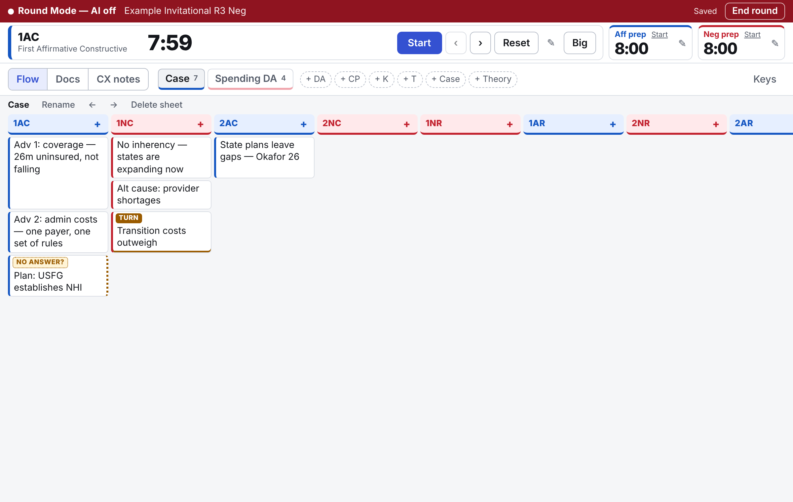
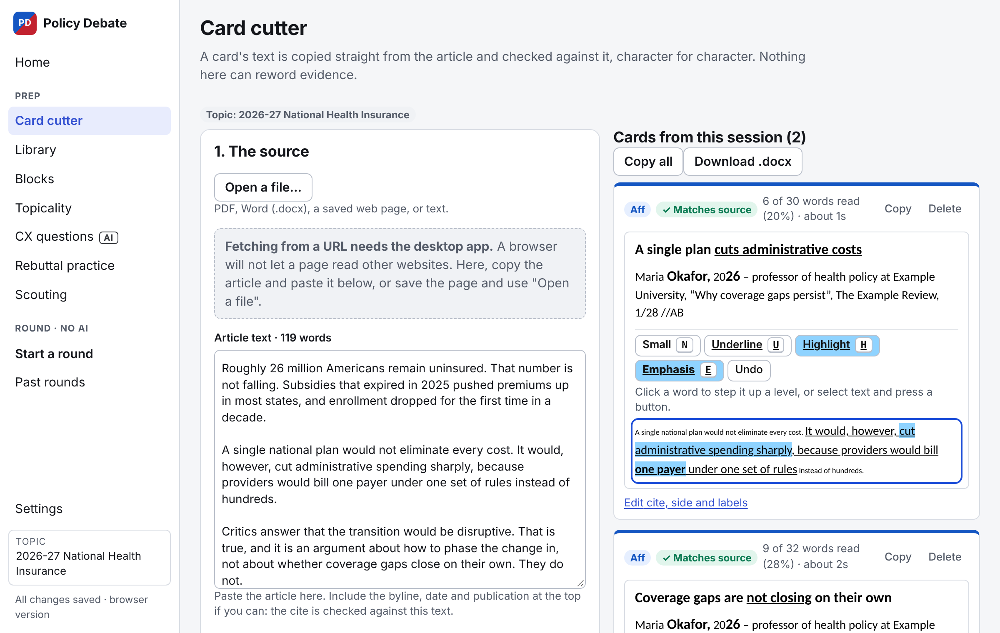
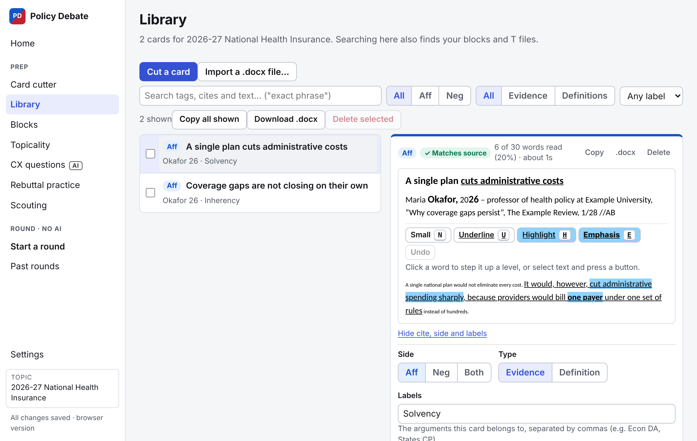
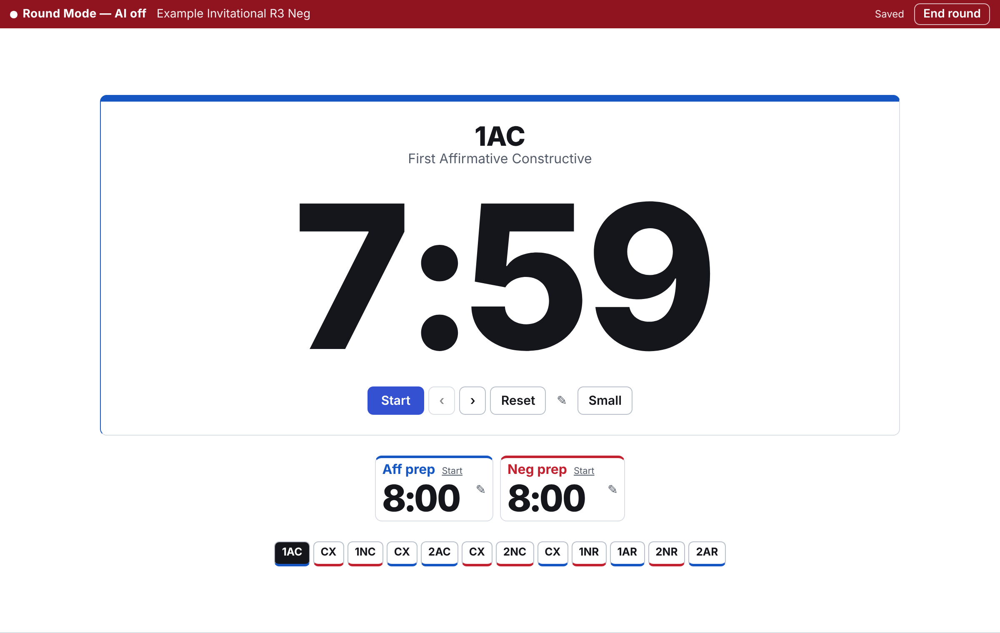
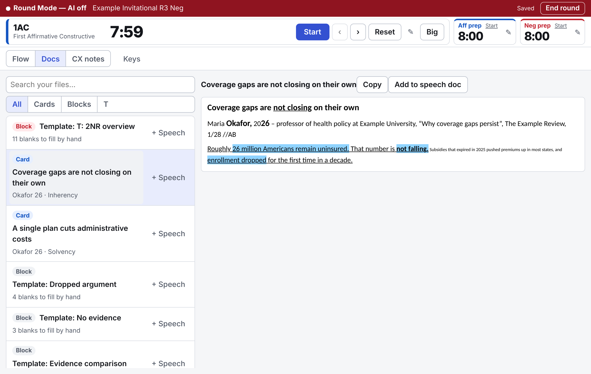
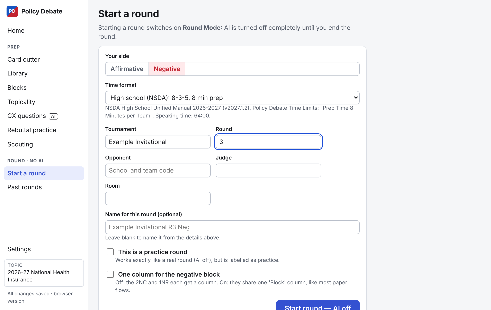
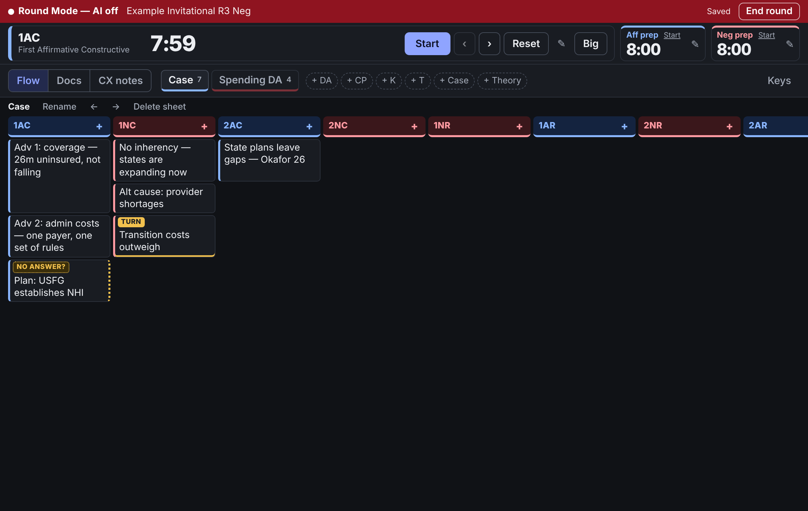

# Policy Debate

A free app for policy debaters: **flow, time, and read your files during a round, and cut cards and build blocks before it.** It works offline, keeps everything on your own computer, and needs no account.



## What it does

**In a round**

- **Flow with the keyboard.** One column per speech, a sheet for each position. An answer sits next to the argument it answers. Extensions, turns and dropped arguments are marked.
- **Timers** for every speech, each cross-examination, and both teams' prep, with a warning before time runs out and a full-screen clock.
- **Your files:** the cards, blocks and topicality files you prepared, ready to read or collect into a speech doc.
- **CX notes** and your own scouting notes on the opponent and judge.

**Before a round**

- **Card cutter.** Paste an article or open a PDF or Word file, mark what you will read, and save it as a card in standard format. The card's words are copied from the source and can never be changed.
- **Library.** Search everything you have cut. Export to Word (works with Verbatim) or copy into Google Docs.
- **Blocks and templates**, **topicality** shells and answers, timed **rebuttal practice**, and **scouting** notes.

**The rule the app is built around: no AI during a round, ever.** Starting a round switches every AI feature off inside the code, not just on screen, and shows a "Round Mode — AI off" banner until you end the round.

## Screenshots

| | |
|---|---|
|  **Card cutter** |  **Library** |
|  **Big timer** |  **Your files in a round** |
|  **Starting a round** |  **Dark theme** |

Everything in these pictures is made up, including the article and its author.

## Download

**[Get the latest version here](https://github.com/Zavvhack/policy-debate/releases/latest)**, then pick the file for your computer:

| You have | Download the file ending in |
|---|---|
| Windows 10 or 11 | `-setup.exe` |
| A Mac (macOS 10.15 Catalina or newer) | `.dmg` |
| A Chromebook, a school computer you cannot install on, or you just want to try it | `policy-debate.html` |
| Linux: Fedora, Nobara, openSUSE | `.rpm` |
| Linux: Ubuntu, Debian, Mint, Pop!_OS | `.deb` |
| Linux: Arch, or anything else | `.AppImage` |

There are two forms of the app. They look and work the same:

| | Desktop app | Browser version (`policy-debate.html`) |
|---|---|---|
| What it is | A normal installed program | One file you open in a browser |
| Works offline | Yes | Yes |
| Needs installing | Yes | No. It also runs from a USB drive |
| Where your work is kept | In the app's folder on your computer | Inside the browser you opened it with |
| Automatic backup copies on disk | Yes | No: download a backup file from Settings now and then |
| Open an article straight from a web address | Yes | No: paste the text, or open a saved file |

### Windows

1. Run the `-setup.exe` file.
2. Windows shows a blue box: **"Windows protected your PC"**. This is expected (see [Why the warnings?](#why-the-warnings)). Click **More info**, then **Run anyway**.
3. Follow the installer, then open **Policy Debate** from the Start menu.

On Windows 10 the installer needs the internet once, to fetch a Microsoft component the app uses (WebView2). Windows 11 already has it.

### Mac

1. Open the `.dmg` file and drag **Policy Debate** into **Applications**. The same file works on Apple Silicon and Intel Macs.
2. Open the app. macOS refuses the first time: **"Policy Debate" cannot be opened** or **Apple could not verify…**. This is expected. Close that message.
3. Open **System Settings → Privacy & Security**, scroll down, and click **Open Anyway** next to the line about Policy Debate. Confirm with your password or fingerprint.

You only do this once. On older versions of macOS you can instead hold **Control**, click the app, and choose **Open**. If neither works, open the Terminal app and paste this line:

```
xattr -dr com.apple.quarantine "/Applications/Policy Debate.app"
```

### The browser version

Double-click `policy-debate.html`. It opens in your browser and works with no internet.

Two things to know:

- **Your work is stored in that browser, on that computer.** It is not inside the file, so it does not travel on a USB drive, and clearing the browser's history and site data erases it. Open **Settings → Backup** and press **Download a backup file** regularly. To move to another computer, restore that file there.
- **Keep the file in one place.** Some browsers tie your saved work to the file's exact name and folder. When a new version comes out, save it over the old file, in the same folder, with the same name. Download a backup first, to be safe.

### Linux

**Fedora, Nobara:**

```
sudo dnf install ./policy-debate_*_linux_x86_64.rpm
```

**Ubuntu, Debian, Mint:**

```
sudo apt install ./policy-debate_*_linux_amd64.deb
```

**AppImage (any distribution):**

```
chmod +x policy-debate_*_linux_x86_64.AppImage
./policy-debate_*_linux_x86_64.AppImage
```

Then find **Policy Debate** in your application menu. If the AppImage opens a blank window, start it with `WEBKIT_DISABLE_DMABUF_RENDERER=1` in front, or use the `.rpm` or `.deb` instead.

### Why the warnings?

Windows and macOS warn about any program whose maker has not paid Microsoft or Apple for a certificate (a few hundred dollars a year). This app is free, so it has none. The warning means "we cannot check who made this", not "this is harmful".

What you can check yourself: every download is built by GitHub directly from the code in this repository, and each release includes a `SHA256SUMS.txt` file for checking that a download arrived intact. Only download the app from this page.

## Getting started

The first time you open the app, a short welcome explains where things are. After that:

1. **Try a practice round.** Press **Start a round**, switch on **This is a practice round**, and flow a speech from a video. `Enter` makes a new argument, `Tab` answers it, and `Alt` + `/` lists every shortcut.
2. **Cut a card.** Open **Card cutter**, paste an article, select a passage, and press **Cut the selected text by hand**. Click words to underline and highlight them.
3. **Set your initials** in **Settings → Cards**, so your cites end with them.
4. **Check the timer format** in **Settings → Timers**. NSDA high school times (8-3-5, 8 minutes of prep) are the default. Other leagues differ.

The keys you will use most while flowing:

| Key | What it does |
|---|---|
| `Enter` | New argument below |
| `Tab` | Answer this argument, in the other team's next speech |
| `Alt` + `E` | Extend this argument, in your own next speech |
| `Shift` + `Tab` | Back to the argument being answered |
| `Ctrl` + `D` | Mark as dropped |
| `Alt` + `Z` | Undo (your typing is kept). `Alt` + `Shift` + `Z` redoes |
| `Alt` + `S` | Start or stop the speech timer |
| `Alt` + `A`, `Alt` + `N` | Aff prep, Neg prep |
| `Alt` + `.` | Next speech |
| `Esc` | Leave the flow grid |

On a Mac, `Alt` is the **Option** key, and `Ctrl` can also be **Command**.

### Card format

Cards follow the usual format, so they paste cleanly into a speech doc:

| Part | How it looks |
|---|---|
| Tag | Bold, 13pt |
| Cite | Author's last name and the year's last two digits in bold 13pt; the rest in 11pt; ending with your initials, like `//AB` |
| Text you will not read | Small (7pt) |
| Underlined | 11pt, underlined |
| Text you read | 11pt, underlined, highlighted |
| Emphasis | 11pt, bold, underlined, highlighted |

Highlighting is red/pink for neg and blue for aff. **Settings → Cards** changes the colours, and has a mode that uses Word's own highlighter colours for Verbatim users.

### A new season

**Settings → Topics → Add a topic.** Paste the exact resolution and press **Make active**. Each topic keeps its own cards, blocks and topicality files.

## Using AI responsibly

**You do not need AI to use this app.** Flowing, timers, the library, cutting cards by hand, blocks, templates and topicality files all work without it. If you have no key, AI controls are a one-line note, or you can hide them completely in **Settings → AI**.

If you choose to use it:

- **AI is optional and uses your own account.** It needs your own Claude API key from Anthropic, which is a paid service. The app shows a rough cost before each request. Ask a parent, guardian or coach before setting up a paid account.
- **AI is for prep only.** It can suggest which words of an article to highlight, draft block points and cross-examination questions for you to rewrite, and give feedback on practice speeches.
- **Round Mode has no AI.** Not a limited version, not a hidden one. Starting a round turns it off in the code, and only ending the round turns it back on.
- **AI cannot be cited as evidence, and every card must come from a real source.** The app is built so AI cannot write or reword evidence: it may only mark words that are already in the article, and the card is checked against the article. Anything AI writes (tags, analysis, feedback) is labelled **AI draft**. Read the original source yourself, and put arguments in your own words.
- **AI makes mistakes.** It can misread an article, and it can sound confident while being wrong. The app flags quotes and cite details it cannot find in your material, but checking is your job.
- **Rules differ by league, and they change. Check yours.** For example, the NSDA's 2026-27 high school rules say generative AI "should not be cited as a source" and that the original source of any evidence "must be available if requested". Many leagues, states and tournaments are stricter, and some restrict AI in prep as well. If you are unsure, ask your coach or the tournament before you use it.

## Privacy

- **Everything you make stays on your computer.** Flows, cards, blocks, notes and settings are saved on your device and nowhere else.
- **There is no account, no server, and no tracking.** The app does not collect or send any information about you or how you use it.
- **The only time anything leaves your computer** is when you choose to: an AI request you start goes to Anthropic (the article text or notes for that request, under your own key and [Anthropic's privacy policy](https://www.anthropic.com/legal/privacy)), and the desktop app fetches a web page when you give it an address.
- **Your API key**, if you add one, is kept in your computer's keychain (desktop app) or in your browser (browser version). It is sent only to Anthropic.
- **Scouting notes** are your own typed notes. The app does not read from Tabroom or openCaselist; it only links to them.

Because your work lives only on your computer, **backups are up to you**: **Settings → Backup → Download a backup file**.

## Your work is saved for you

- Every change is saved within a second. There is no Save button.
- If the window closes while you are typing, the last words are recovered next time.
- Deleted items stay in a trash for 30 days (**Settings → Backup**).
- The app keeps snapshots of everything, taken when a round ends and every few minutes while you work. You can go back to one.
- Closing the app mid-round is safe. Reopen it and you are back in the round, with the timers still right.

## Questions and problems

**The app says it is "already open".** It is open in another window or tab. Use that one. Two copies would save over each other.

**Something went wrong on screen.** Press **Try again**, then **Reload the app** if needed. Your work is saved as you type.

**I lost my work in the browser version.** If the browser's site data was cleared, the only copy is your last backup file: **Settings → Backup → Restore from a file**. This is why regular backups matter.

**The timers have the wrong lengths.** Pick your league's times in **Settings → Timers**, or make your own format.

**A PDF came in jumbled or empty.** Scanned PDFs are pictures and have no text to read; two-column pages can come out in the wrong order. Copy the text from the PDF and paste it instead.

## Report a bug or ask for a feature

**[Open the Issues page](https://github.com/Zavvhack/policy-debate/issues/new/choose)** and choose **Something is not working** or **An idea or a request**. The form asks a few plain questions; you do not need to know anything about programming. You need a free GitHub account to post.

Please do not paste real evidence files, anyone's name, or an API key into a report.

## For developers

The app is open source under the [MIT licence](LICENSE). It is built with TypeScript, Preact and Tauri, from one codebase.

- [CONTRIBUTING.md](CONTRIBUTING.md): how to help, and three rules the code may never break
- [docs/DEVELOPING.md](docs/DEVELOPING.md): building, testing, and how the code is organised
- [CHANGELOG.md](CHANGELOG.md): what changed in each version
- [PROGRESS.md](PROGRESS.md): what has been tested, what has not, and known limits
- [THIRD-PARTY-NOTICES.md](THIRD-PARTY-NOTICES.md): the open-source libraries inside the app
- [SECURITY.md](SECURITY.md): reporting a security problem

Policy Debate is not affiliated with or endorsed by the NSDA, the NFHS, Anthropic, Tabroom, openCaselist or Paperless Debate.
